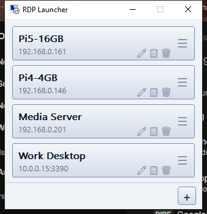

<div align="center">

# 🖥️ RDP Launcher

**One-click RDP connection launcher for Windows — a single tiny native `.exe`, zero dependencies.**

*by [c1t1zen](https://github.com/c1t1zen1)*




🍎 **New: RDP Launcher for Mac** — first release (v1.0.0), still in testing. [Details below ↓](#-macos-edition)

</div>

---

## ✨ Features

- **One-click launch** — big rectangle buttons, one per saved connection. Click and you're in.
- **Auto-login** — saves host, username, and password, so `mstsc` connects without prompting.
- **Live status** — buttons glow **light green** while their RDP session is running.
- **Animated drag to reorder** — grab the `≡` handle on the right edge of any button and drag up/down; the other buttons spring out of the way with a smooth, slightly bouncy animation.
- **Quick actions on every button** — tiny ✏️ edit, 📋 duplicate, and 🗑️ delete icons in the bottom-right corner, plus a full right-click menu (🖥️ Connect, ✏️ Edit / Rename, 📋 Duplicate, 🗑️ Delete).
- **Always on top** — the launcher stays visible so you can open multiple sessions.
- **Auto-expanding, scrollbar-free** — the window grows and shrinks with your list (mouse-wheel scrolls silently if it ever outgrows the screen).
- **Native look** — pure Win32, silver/blue gradient buttons, Segoe UI, embedded Remote Desktop icon.

## 🚀 Getting started

1. Grab `rdp-launcher.exe` (build it yourself below, or download from [Releases](https://github.com/c1t1zen1/RDP_Launcher/releases)).
2. Run it — no installer, no services, no runtime dependencies. Pin it to your taskbar if you like.
3. Click the **+** button (bottom-right corner) and enter:
   - **Name** — any friendly label (rename anytime via right-click)
   - **Host / IP** — e.g. `192.168.0.161` or `server:3390`
   - **Username / Password** — optional; leave blank to be prompted on connect
4. Click the big button to launch the session. Done.

## 🔐 Storage & security

| What | Where / How |
|---|---|
| Connection list | `%APPDATA%\RdpLauncher\connections.json` |
| Passwords | Encrypted with **Windows DPAPI** — only your Windows user account can decrypt them |
| Login handoff | Credentials registered via `cmdkey` (`TERMSRV/<host>`), then `mstsc` is started with a generated `.rdp` file |

No cloud, no telemetry, nothing leaves your machine.

## 🛠️ Building from source

Requires only a stable [Rust](https://rustup.rs/) toolchain:

```powershell
git clone https://github.com/c1t1zen1/RDP_Launcher.git
cd RDP_Launcher
cargo build --release
```

The result is a single self-contained executable (static CRT — no DLLs, no installs):

```
target\release\rdp-launcher.exe
```

To regenerate the embedded icon from Windows' own Remote Desktop icon:

```powershell
powershell -ExecutionPolicy Bypass -File tools\make_icon.ps1
```

## 📁 Project layout

```
RDP_Launcher/
├── src/main.rs          # Entire app: pure Win32 GUI, owner-drawn buttons, DPAPI, launcher
├── build.rs             # Embeds icon + version info into the exe
├── assets/
│   ├── app.ico          # Multi-size application icon
│   └── screenshot.png   # README screenshot
├── tools/
│   ├── make_icon.ps1    # Extracts the Windows RDP icon into app.ico
│   └── screenshot.ps1   # Captures the app window for the README
├── macos/               # macOS edition — separate Cargo project (see macos/README.md)
├── .cargo/config.toml   # Static CRT + self-contained linker settings
└── Cargo.toml
```

## 🧩 Tech notes

- **Zero frameworks** — raw Win32 via [`windows-sys`](https://crates.io/crates/windows-sys); owner-drawn buttons with GDI gradients.
- **Tiny** — `opt-level = "z"`, LTO, stripped, `panic = "abort"` → a few hundred KB.
- **Drag-reorder** — button windows are subclassed; the `≡` handle captures the mouse while a 15 ms spring-physics timer (`stiffness 0.30, damping 0.70`) animates the other buttons into place with a subtle bounce.
- **Session tracking** — spawned `mstsc` process handles are polled every second to drive the green "connected" state.

## 🍎 macOS edition

> **⚠️ First release — testing phase.** macOS **v1.0.0** is the first version of RDP Launcher
> for Mac and is still being tested. Expect some rough edges, and please
> [open an issue](https://github.com/c1t1zen1/RDP_Launcher/issues) if something doesn't work.
> The Windows app is unaffected.

The Mac version is the same launcher — big buttons, green while connected, drag to
reorder — but macOS has no built-in Remote Desktop client, so it carries its own, built on
the pure-Rust [IronRDP](https://github.com/Devolutions/IronRDP) library. Nothing else to install.

- **One-click launch** — clicking a connected server brings its window back instead of opening a second one.
- **Full screen or windowed, per connection** — full screen gets its own Space (three-finger swipe
  between servers); windowed sessions resize the remote desktop as you drag the window edge.
- **Multi-monitor** — one remote desktop across two or more selected displays.
- **Clipboard, sound and a shared folder** — copy & paste text both ways, hear remote audio, and
  share a Mac folder that shows up on the remote PC.
- **Mac-friendly keyboard** — ⌘C/⌘V/⌘Z act as Ctrl+C/V/Z remotely; tap ⌘ alone for the Windows key.
- **Works with Windows (NLA) and Linux/xrdp servers.**

| | Windows | macOS |
|---|---|---|
| Requires | Windows 10/11 | macOS 13+ on Apple Silicon |
| Package | single `.exe` | `.app` in a drag-to-install `.dmg` |
| RDP client | Windows' own `mstsc` | built in (IronRDP) |
| Passwords | Windows DPAPI | macOS Keychain |
| Server identity | handled by `mstsc` | trust-on-first-use certificate fingerprint |
| Connection list | `%APPDATA%\RdpLauncher\connections.json` | `~/Library/Application Support/RdpLauncher/connections.json` (same format) |

**Download:** `RDP-Launcher-1.0.0.dmg` from the
[macOS v1.0.0 release](https://github.com/c1t1zen1/RDP_Launcher/releases/tag/macos-v1.0.0) (pre-release).
Open it, drag **RDP Launcher** into **Applications**, and click **Allow** when macOS asks for
Local Network access on your first connection.

The app isn't notarized by Apple, so the first launch of a downloaded copy is blocked with
"Apple could not verify…". On macOS 15+, go to System Settings → **Privacy & Security** and click
**Open Anyway**; on macOS 13–14, right-click the app → **Open**.

**Or build it yourself** (needs the Xcode Command Line Tools and [Rust](https://rustup.rs/)):

```bash
git clone https://github.com/c1t1zen1/RDP_Launcher.git
cd RDP_Launcher/macos
./scripts/build-app.sh        # → macos/dist/RDP-Launcher-1.0.0.dmg
```

Linux/xrdp servers need TLS enabled. If you see `server selected STANDARD_RDP_SECURITY`,
follow the [xrdp TLS setup](macos/README.md#xrdp-selects-standard-rdp-security).

Full Mac docs: [macos/README.md](macos/README.md) · manual test checklist: [macos/TESTING.md](macos/TESTING.md)

## 📋 Changelog

### macOS — unreleased fixes
- Request RDP auto-login when a username and password are supplied, including on TLS-only xrdp servers.
- Report Keychain access and password-saving errors instead of silently losing saved credentials.
- Explain the TLS requirement and xrdp configuration fix when a server selects legacy Standard RDP Security.

### macOS v1.0.0 — first release (testing phase)
- First version of RDP Launcher for Mac, with a built-in RDP client.
- Full screen / windowed sessions, multi-monitor, clipboard, sound, shared folder, Keychain passwords.
- Fixed xrdp sessions dropping when the session window is resized.

### v1.1.0 (Windows)
- Fixed a glitch that caused connection buttons to shift order erratically.
- Moved the app icon to the right side of the taskbar (system tray/notification area).

## 📄 License

[MIT](LICENSE) © 2026 [c1t1zen](https://github.com/c1t1zen1)
