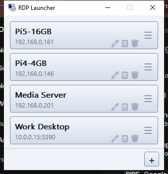

<div align="center">

# 🖥️ RDP Launcher v1.0.0

**One-click RDP connection launcher for Windows**

*by [c1t1zen](https://github.com/c1t1zen1)*

</div>

---

## 🚀 What's New

### ✨ First stable release — everything you need, nothing you don't.

No installers. No services. No runtime dependencies. One `.exe`, double-click, done.

---

## 🎯 Features

| Feature | Description |
|---------|-------------|
| 🖱️ **One-Click Launch** | Big rectangle buttons — click any saved connection and `mstsc` opens instantly |
| 🔐 **Auto-Login** | Host, username & password stored; RDP connects without prompting |
| 🟢 **Live Status** | Buttons glow **light green** while their RDP session is running |
| 🎬 **Animated Drag Reorder** | Grab the **≡** handle and drag — other buttons smoothly spring out of the way |
| ⚡ **Quick Actions** | **✏️ 📋 🗑️** icons on every button for edit, duplicate, delete |
| 📐 **Auto-Resizing** | Window grows and shrinks with your list — no scrollbar |
| 📌 **Always On Top** | Launcher stays visible so you can open multiple sessions |
| 🎨 **Native Look** | Silver/blue GDI gradients, Segoe UI, embedded Windows RDP icon |

---

## 📸 Screenshot



---

## 📥 Download

| Asset | Size |
|-------|------|
| `rdp-launcher.exe` | ~400 KB |

⬇️ **Grab the `.exe` from the Assets section below and run it anywhere.**

---

## 🛠️ Build from source

```powershell
cargo build --release
```

Requires only [Rust](https://rustup.rs/). The result is a single self-contained executable.

---

## 🔐 Security

- Config stored in `%APPDATA%\RdpLauncher\connections.json`
- Passwords encrypted with **Windows DPAPI** (only your account can decrypt)
- No cloud, no telemetry

---

## 🧩 Tech Stack

- **Language:** Rust 1.96
- **UI:** Pure Win32 via `windows-sys` (owner-drawn buttons, GDI)
- **Animation:** Spring-physics timer (`stiffness 0.30`, `damping 0.70`) at ~60 Hz
- **Icon:** Extracted directly from Windows `mstsc.exe`
- **Size:** `opt-level = "z"`, LTO, stripped — a few hundred KB

---

## 📄 License

[MIT](LICENSE) © 2026 [c1t1zen](https://github.com/c1t1zen1)
